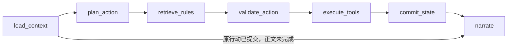

# 单 Agent 的实现方法

## 为什么需要 Agent

玩家的自由输入可能是行动、问题、假设、否定或省略回答。系统需要结合当前进度决定下一步：
是查规则、操作物品、移动，还是先追问。工具结果又会改变下一轮能看到的对象和能执行的行动。

本项目用一个 AI KP 完成这个循环。AI 负责语言理解和叙述，程序负责限制可执行范围与保存真实状态。
不是给每个 NPC 或每个场景各创建一个 Agent。

## 七阶段图



图由 [KeeperService._build_graph](../backend/kp_agent/graph.py) 定义，
网页阶段逻辑由 [WebKeeperService](../backend/kp_agent/web.py) 实现。
原图还包含处理关闭状态的短路节点；上图画的是正常网页行动与恢复的主要路径。

| 阶段 | 输入与产物 |
|---|---|
| 加载 | 读取当前局与原请求；近期公开对话最多截取一段，不把完整隐藏配置放进上下文 |
| 规划 | 输出 `WebActionPlan`，包含意图、目标、方法、物品或追问；不包含出目或资源增减 |
| 检索 | 为规则问题或实际检定检索本轮证据，保存证据列表 |
| 验证 | 形成 `ExecutionRequest`；只允许受控工具，或明确的不执行回复 |
| 执行 | 使用确定的故事与数值工具，产生已核对的结果 |
| 提交 | 保存回合、版本、出目、资源、物品和进度；向网页发布已提交结果 |
| 叙述 | 只用已提交公开事实和本轮规则依据生成正文；保存完成消息 |

## 规划输出与工具边界

结构定义在 [schemas.py](../backend/kp_agent/schemas.py) 和 [contracts.py](../backend/kp_agent/game_tools/contracts.py)。
网页工具名包括 `observe`、`inspect`、`talk`、`move`、`take`、`use_item`、`drop`、`give`、`finish`、`confirm_action`，
也保留受工具契约约束的 `interact`。并非每个名字在每个地点都可使用。

例如，玩家说“查看铁柜编号，寻找照片中的位置”，可得到如下行动提议：

```json
{
  "intent": "inspect",
  "target_id": "locker",
  "option_id": "investigate",
  "skill": "侦查",
  "item_id": null,
  "query": null,
  "question": null,
  "approach": "查看铁柜编号，寻找照片中的位置"
}
```

这个对象只是提议。程序仍要核对柜子是否在当前位置、对应方法是否可用、技能是否符合配置。
“侦查 55”来自保存的角色，而不是这个 JSON；出目由后端工具产生。

## 追问与玩家意图

- 明确且唯一的页面行动建议直接映射到当前工具，避免被模型换成另一个对象。
- 自由输入交给模型理解，并保留目标／物品一致性保护。
- “如果检查会怎样”“我不想使用绷带”等不直接产生行动后果。
- 对象冲突时直接提出具体问题，例如“你指的是寄存铁柜（查看编号……），还是其他对象？”
- 只有上轮保存了唯一候选，且仍处于同一场景时，下一轮“对”才会重新核对并继续该行动。
- 无效的规划格式转为对当前公开对象的追问，不猜测执行，也不后台重试供应商请求。

对应实现是 [models.py](../backend/kp_agent/models.py) 的 `_web_prefilter`、`_validate_web_plan`、
`_web_choice_plan`、`_web_target_clarification` 和 `web.py` 的 `_plan`。

## 确认不等于真人 KP 审批

AI 直接主持当前故事。结束调查需要玩家确认，以防咨询或误点立即结案。
确认 ID、原请求与最新状态都要匹配；取消后继续原进度。
这不是每轮等待另一位真人 KP 批准，也没有多个 Agent 投票。

## 一轮不一定调用两次模型

一般自由行动可能使用一次规划调用和一次叙述调用；明确建议、当前数值读取、固定规则算例、
确认提示或受控追问可以省掉其中一次或两次调用。RAG 的本地关键词检索本身不调用模型。
不能用玩家回合数直接推算 API 请求数；实验应读调用元数据。

## 恢复与重复请求

状态区分计划、已保存随机结果、已提交效果和已完成正文。
同一请求重复提交必须保留内容；已完成则返回原状态，不再执行。
叙述中断后，已提交的出目、物品和资源保持原样，恢复原请求只补正文。

这里的图状态主要在每次调用期间使用；持久化由项目自己的 JSON 存档和检查点完成，
不应写成已经部署了 LangGraph 的独立持久化数据库。

## 可用于报告的例子

“用黄铜钥匙打开站台”即使被模型误解为开柜子，也不能执行。
这个例子说明：**工具调用合法不代表忠实于玩家意图**。因此报告应同时讨论模型理解、程序验证和实际状态结果。
历史原始／最终评分见 [实验索引](evaluation/README.md)，最新网页回归见 [测试报告](evaluation/2026-10-26-test-report.md)。
