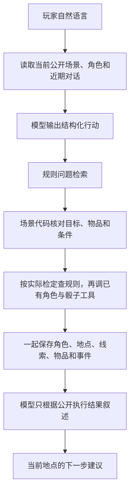

# Agent＋RAG v2：实际代码与组内分工

当前源码已迁至 `backend/`；本文代码和数据路径相对该目录。React/FastAPI 已有工程骨架与健康接口，游戏 HTTP 接入仍待实现。当前工程边界以 [architecture.md](architecture.md) 为准。

## 这版做什么

一名玩家、一张固定角色卡、一个 AI KP。故事为原创的“旧书房 → 旧车站 → 地下档案室”，沿用组员提供的角色、骰子和规则基础代码。正常行动由 AI 主持，异常情况给出暂停或接管提示。

这里实现的是 Agent＋RAG 和调用已有功能所需的适配。网页、HTTP 路由、底层引擎和最终数据库由各自负责的同学继续完成。

## 一次行动的实际流程

LangGraph 对应 `load_context → plan_action → retrieve_rules → validate_action → execute_tools → commit_state → narrate`。
检定所用技能由场景核对后确定，所以 `execute_tools` 中还会检索实际技能的依据。
整局结束／暂停时走 `closed_game`；已保存行动而叙述失败时直接恢复叙述。

## 模型和代码分别决定什么

| 内容 | 谁决定 |
|---|---|
| 玩家这句话想观察、交谈、移动还是使用物品 | 模型理解，随后本地校验 |
| 缺少对象、去向不明 | 追问 |
| 玩家在问怎么结束，还是实际要求结束 | 模型判断，并有本地防误执行处理 |
| 当前目标、出口、物品和可用动作 | 场景代码从当前进度整理 |
| 检定技能、难度、效果和线索条件 | 预先写好的场景配置 |
| 随机骰子、角色数值计算 | 组员已有 `trpg`，由 `CharacterTools` 调用 |
| 本次行动是否提交、相同消息是否处理过 | 已有 `Storage` |
| NPC 说话方式、结果的自然表达 | 模型根据已公开事实叙述 |
| 规则解释的依据 | RAG 返回的来源摘要 |

模型输出只有 `intent/target_id/item_id/query/question`，没有任意函数名、骰子出目、HP 改变量等字段。
这是受限动作规划和程序执行，不是模型直接连接任意 MCP 工具。

## 场景与进度

`data/campaign.json` 定义故事、物品、使用条件、地点文件和结局。
三个地点的对象、NPC、调查、线索及出口在 `data/scenes/study.json`、`station.json`、`archive.json`。

- 全局保存：当前位置、已访问地点、已获得线索、库存、异常状态、累计耗时、日初 SAN、累计 SAN 损失、效果执行记录和结局。
- 各地点保存：调查尝试、已交谈 NPC、已经使用物品的记录。
- 切换前保存当前地点，回访时恢复原进度；不重新发钥匙、不重新扣同一事件的 SAN。
- 三处重要调查都有失败后的耗时补救，具体分钟数来自公开行动。
- 已获得信件、照片和物品可按 `clue_…/item_…` 公开对象只读查看，不能重新调查获得奖励。
- 前往／回访是移动；明确停止调查或从最终安全出口离开才结束整局。
- 完整结局要求在最后地点完成条件并离开，不能在返回书房后套用最终安全出口的叙述。
- 整局结束后才提供全局复盘；复盘不会补发遗漏物品或改变状态。

初态保存 `campaign_id` 与完整配置的 `campaign_revision`。配置变化时拒绝用旧存档继续，避免旧骰子被用于新的剧情后果。
旧书房单场景调试使用 `data/scenes/study_legacy.json`，不会把完整故事地点误当作有独立库存的旧版本。

## 信息怎样提供给模型

完整场景 JSON 留在程序内部。规划只收到当前可见目标、可走路线、已获线索、物品、角色和近期对话。
物品公开资料包含名称、别名、说明、数量；隐藏使用条件和奖励不直接放入模型上下文。
叙述只收到本次公开事件、工具真实结果、当前公开进度和本次规则依据。后续地点的秘密不会因为整份 JSON 已加载就进入提示词。

网页同学只接 `KeeperService` 的公开返回，不把整个 `data/` 作为可供玩家下载的静态目录。

## RAG

三个地点共用 `data/agent_rules.md` 的 17 个已核对主题。
默认关键词检索，规则按章节切块，返回稳定来源编号、摘要、版本与 PDF／书内页码。
玩家直接提问时查问题；实际行动时查场景确定的技能；理智事件查理智规则。
空检索结果允许明确表示资料不足。引用编号由程序检查，历史回答的引用不能直接充当本轮依据。

剧情没有混入规则库。是否打开某个柜子、获取某条线索或移动到下一地点，仍由结构化场景判断。
可选向量模式沿用已有 embedding 适配和缓存，需要单独配置服务，不是本故事的必需项。
本故事的止血包恢复 2 HP、花时间补查等属于已公开的简化约定，不冒充 COC 通用急救或通用孤注一骰。

## 现有工具如何接

`kp_agent/tools.py` 是调用适配层，`trpg/` 的数值算法保持原样。

- `skill_check`：核对技能、难度和奖惩骰，调用现有 `Character.check`。
- `expression`：限制骰子表达式并调用现有 `roll`，不使用 eval。
- `apply_effects`：只接场景预先给出的 SAN／伤害／恢复／MP 消耗。
- HP 伤害与 HP／MP 恢复调用已有角色方法；场景 MP 消耗只作有界成本处理，未实现通用施法。
- 结算先在副本完成，再与剧情、物品一起提交。满值使用单纯恢复道具会退回整次物品消耗。
- 同一行动的效果集合有指纹，已应用的集合不能改成另一组再执行。

主线不使用法术。可选站台事故是一次 DEX 检定及失败时的轻伤，普通调查失败不会一律扣血。

## 保存与重试

沿用 `Storage` 原来的 SQLite 表和事务，不新增数据库底层。
消息编号、行动编号和骰子编号用于识别重复请求；同一消息更换内容会被拒绝。
随机结果先保存，角色与剧情统一提交。叙述中断后重试同一消息，使用保存的行动结果，不重掷或再次消耗物品。
未完成的消息先恢复，再接新行动；重开另建游戏编号。

## 给组员的 Python 入口

`KeeperService` 提供开始／恢复、发消息、查消息、读聊天、读角色、读公开进度、读物品、读线索、读已提交骰子、重开与关闭。
具体参数和返回字段见 `docs/interfaces.md`。
本版本没有实现 React 页面或 FastAPI 路由；说明里的 HTTP 地址只是给队友讨论的对应关系。

## 检查记录

本次新增的离线测试和 DeepSeek 泛化检查与旧 v1 分开。以 `output/qa/` 的本次实际记录为准，不用 v1 的测试数量代表 v2。
真实模型的成功案例只能说明这些输入下的表现，不代表任意开放行动或全部 COC 系统都已实现。
