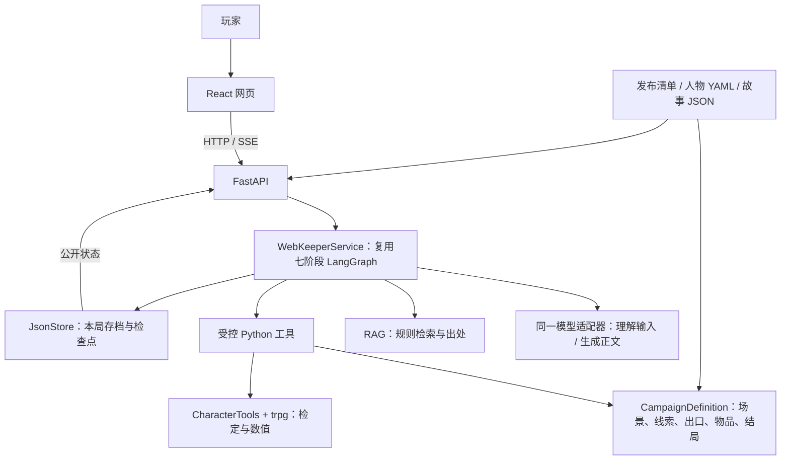

# 当前系统架构

代码基线：main `74d2c34`，2026-10-26。

## 总体结构

玩家在 React 网页输入行动；FastAPI 接收请求；同一套 LangGraph Agent 理解行动、查规则，
再由 Python 工具检查并执行。最终状态保存后，AI 才根据真实结果生成正文。

## 每部分做什么

| 部分 | 职责 | 对应代码 |
|---|---|---|
| 网页 | 人物与故事浏览、输入、检定卡、背包、线索、对话、复盘 | [frontend/src](../frontend/src) |
| HTTP 层 | 输入格式、状态码、生命周期、SSE 输出 | [app/api](../backend/app/api) |
| Agent 编排 | 加载、规划、检索、验证、执行、提交、叙述 | [graph.py](../backend/kp_agent/graph.py)、[web.py](../backend/kp_agent/web.py) |
| 模型适配 | DeepSeek Responses、结构化输出、中文保护、流式正文、调用元数据 | [models.py](../backend/kp_agent/models.py) |
| 规则检索 | 从本地核对过的规则片段找依据 | [retrieval.py](../backend/kp_agent/retrieval.py)、[rules_store.py](../backend/trpg/rules_store.py) |
| 故事工具 | 核对当前位置、前提、已做行动、奖励、出口与结局 | [owned_tools.py](../backend/kp_agent/owned_tools.py)、[campaign.py](../backend/kp_agent/campaign.py) |
| 数值工具 | 百分骰、成功等级、HP/SAN/MP、效果边界 | [tools.py](../backend/kp_agent/tools.py)、[trpg](../backend/trpg) |
| 保存 | 校验和、原子写入、备份、进程锁、回合检查点 | [game_tools/store.py](../backend/kp_agent/game_tools/store.py) |

## 两条入口，共用原有能力

网页是本次展示入口：`app.main` → `WebKeeperService` → 原七阶段图。
`WebKeeperService` 继承 `KeeperService`，复用其图结构，使用网页自己的 HTTP/SSE 和 JSON 保存方式。
它不是另加一个自主 Agent。

CLI 保留原 `KeeperService` 与 SQLite，主要用于离线演示、调试和原有检查。
不能把 CLI 的方法名、SQLite 表或 `/retry` 当成网页 HTTP 接口；两种存档格式也不互相复制。

## 一轮行动的顺序

1. 读取保存的角色、当前位置、已获线索、物品和近期对话。
2. 形成当前公开对象与合法工具列表，理解玩家意图。
3. 按问题或检定主题检索规则，不将完整隐藏剧情交给模型。
4. 验证目标、物品、技能、前提与当前确认状态。
5. 执行确定工具，随机结果先保存，效果在副本计算。
6. 一次提交人物、物品和故事进度，再把检定与状态发送给网页。
7. 模型根据已提交公开结果生成正文；完成后保存正文与完成状态。

恢复已经提交的原回合时跳过再次执行，直接恢复叙述；细节见 [Agent](agent-design.md)。

## 如何复用人物和故事

发布清单中的 `campaignFile` 指向当前工具支持的故事文件，`investigatorIds` 决定人物资料，
`playableInvestigatorIds` 决定哪些人物可以开始调查。初始化读取人物 YAML，而不是在 Python 中写死人物属性。
NPC 从故事目标的交谈动作读取，物品从故事配置与人物 `starting_equipment` 读取。

因此，符合现有机制的新人物和故事可以复用同一套 Agent。
新故事仍必须提供出口、前提、线索、效果与结局；单有 PDF、图片或人物档案不能自动变成可玩的故事。

## 当前没有采用的部分

当前没有多 Agent 相互协商、外部 MCP 调用、联网多人、账号系统、向量数据库或完整战斗／施法。
这些不应画进“已经实现”的架构图。扩展方向可以在讨论部分单独提出。
