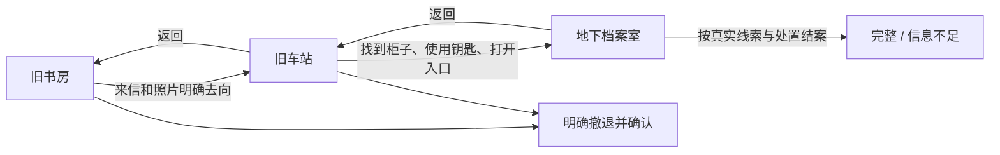

# 场景、人物、物品和保存

## 静态资料与本局进度

| 数据 | 位置 | 用途 |
|---|---|---|
| 发布目录 | [module-catalogue.json](../backend/data/module-catalogue.json) | 允许显示的故事、人物、可开局名单 |
| 人物模板 | [data/characters](../backend/data/characters) | 属性、技能、初始资源、物品、背景和头像 |
| 原角色卡 | [backend/characters](../backend/characters) | 理查德原始 Excel，作为导入和核对来源 |
| 当前可玩故事 | [campaign.json](../backend/data/campaign.json)、[scenes](../backend/data/scenes) | 地点、目标、出口、线索、道具用法、结局 |
| 规则资料 | [agent_rules.md](../backend/data/agent_rules.md) | RAG 的规则依据 |
| 网页存档 | 本机 `backend/saves/<game_id>/game.json` | 当前人物、物品、线索、对话、请求、出目和阶段 |
| CLI 保存 | 本机 SQLite | 原命令行流程的状态，与网页格式独立 |

游玩修改的是本局存档，不是人物 YAML、原始 Excel 或故事模板。
这些本机存档不提交 Git；仓库中供报告使用的 JSON 是明确保留的评估证据。

## 人物初始化

网页按所选人物读取属性与资源；未单独列出的技能可使用现有规则的默认值。
已给出的最大 HP／MP 等原卡数据会被保留，不能让模型另算一套人物数值。
人物模板可以很多，但当前实际开局只开放理查德。

理查德目前有五类随身物品：威士忌小酒壶、打火机、香烟、怪谈手抄本，以及故事提供的简易止血包。
前四项核对来源为原 Excel《人物卡》F79–F82；止血包属于故事安排。
原卡未标数量的项目保持未知，不能为了显示方便擅自设成 1。

`template_inventory()` 递归读取 `starting_equipment`：箱中物品保留收纳说明，
`owned_asset` 及其内容不当作随身物品，容器字段如酒壶会显示在说明里。
资产、现金或原卡武器描述不代表已经具备相应交易、完整武器或战斗功能。

## 故事推进与回访

模型只提出行动；`CampaignDefinition` 核对前提、尝试记录和当前物品，再产生公开结果。
重复搜索不一定得到新骰子；当前故事允许部分失败后明确花十分钟换方法细查。
回访会保留已查内容、打开的入口和已消耗钥匙，不重置事件或重复奖励。

本故事有 complete、incomplete、retreat 三种结局，网页保留 `campaignEnding` 区分。
兼容字段 `ending` 将信息不足也映射到 retreated，因此画面标题不能只看这个兼容字段。
HP/SAN 等异常可能让当前流程暂停并等待真人检查，不能套用其他分支“必然自动结案”的说法。

## 数值只走工具

- 技能／属性检定由保存值、故事难度与受支持的奖惩骰参数确定，调用现有 `Character.check`。
- 伤害、理智损失和恢复来自故事预定义效果；骰子表达式经过限制，不执行任意表达式代码。
- HP、SAN、MP 不越过合法上下限，负数恢复不变成额外伤害。
- 当前止血包是恢复 2 HP、用后消耗的故事约定；满血使用不会浪费一份物品。
- 同一理智事件只结算一次；造成的状态变化和对应检定记录一起保存。
- 当前主线机械封存不施法，因此不会凭空扣 MP。底层有 MP 处理能力不等于已实现完整法术系统。

常用数值例子与真实出目要分开。解释“假设掷出 30”不应新增检定卡、扣血或推进调查。

## 随身物品的归属

背包中的物品可查看；已写明用途的物品可按条件使用。
非关键物品可放在当前地点后拾回，也可交给当前在场 NPC，归属由程序记录。
关键剧情物品受到保护，避免随意丢弃造成无法继续的局面。
不能因为物品名像钥匙就打开所有锁，也不能因为角色有武器描述就让模型即兴结算攻击。

## 保存和中断恢复

存档同时包含当前状态与每个回合的计划、骰子日志、是否提交和正文完成阶段。
随机值先记录；人物、物品和进度在副本中计算后一次提交；正文生成失败不撤销已提交行动。

`JsonStore` 用内容校验和检测意外修改，用同目录临时文件、flush/fsync 和原子替换保存，
更新前保留有效备份。损坏文件不会被自动重置或用备份覆盖。
进程锁限制一个保存根目录只由一个进程／worker 使用；同局锁和未决回合限制防止连续提交。
这不是已经支持多机器或多 worker 的数据库方案。

故事 ID 和配置指纹必须与存档匹配。改了故事规则不能继续拿旧骰子当新规则下的结果。
GET 只读，不自动清空、迁移或推进局面。

本轮遗漏物品修正是用户明确要求后单独执行的操作：停服、备份、只补缺项、验证资源与剧情不变。
[sync_character_equipment.py](../backend/scripts/sync_character_equipment.py) 不是每次读存档自动补发装备的逻辑。

## 与报告相关的证据

- [网页集成测试](../backend/tests/test_web_integration.py)：恢复、损坏、跨局、取放、个人物品。
- [原故事测试](../backend/tests/test_campaign_v2.py)：三地点、线索条件、失败替代、混合效果。
- [本轮物品修正记录](evaluation/equipment-correction.json)。
- [最新测试报告](evaluation/2026-10-26-test-report.md)。
