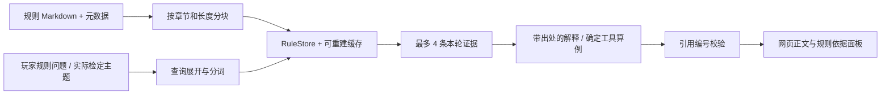

# RAG 在当前项目里的用法

## 检索的是规则依据

规则库是 [agent_rules.md](../backend/data/agent_rules.md)，当前有 17 个核对过的主题，
包括检定、失败、成功等级、侦查、聆听、潜行、奖惩骰、理智、急救和 MP。
片段保存规则摘要、短引、原 PDF 名称、版本以及核对过的 PDF 页码和印刷页码。

运行时读取的是这份整理后的 Markdown，不是每次重新分析整个 PDF。
没有把“17 个主题”说成整本 COC 规则已经完整结构化。

## 检索与生成流程

主要代码：[retrieval.py](../backend/kp_agent/retrieval.py)、[rules_store.py](../backend/trpg/rules_store.py)、
[web.py](../backend/kp_agent/web.py)、[models.py](../backend/kp_agent/models.py)。

## 怎么分块和排序

1. 读取章节标题与 `rule_meta` 元数据。
2. 按段落合并并限制片段长度，默认每块最多约 800 字符；页码没有核对时保持空值。
3. 查询进行大小写统一、英文词与中文二元片段分词，并用少量别名展开，例如“悄悄”关联潜行。
4. 当前网页默认按加权词项重叠排序；较少出现的查询词权重更高，标题／别名匹配有加权。
5. `RetrievalService.search` 默认取前 4 条，返回证据编号、正文、标题、来源、页码、版本与排序分数。

这是项目自带的轻量本地检索，不应称为已经采用 FAISS、Chroma、BM25 或向量数据库。
分数是排序信号，不是“答案正确概率”。

## 缓存与可选 embedding

规则指纹由版本与文件内容计算，缓存可在内容变化或损坏时重建。
底层 `RuleStore` 支持可选 embedding、余弦相似度和向量缓存；CLI 另有环境配置入口。
当前网页直接创建默认 `RetrievalService`，使用关键词模式。不能只改 `.env` 就宣称网页已启用向量检索。
本轮没有做真实 embedding 服务或关键词／向量检索的对比实验。

## 一次真实可演示的规则问答

玩家问：“侦查失败会不会自动扣血？”

系统识别为规则问题，检索“普通失败不会固定扣血”等相关片段，将本轮证据交给解释步骤。
回答指出普通失败通常表示未达成目标，伤害需要具体危险和场景依据；网页可展开规则来源。
询问规则不应自动触发侦查、扣血或推进剧情。

玩家问：“困难成功和极难成功怎么算？”

系统检索成功等级规则，再用保存角色的技能值调用确定工具。
侦查 55 的门槛为 55、27、11；假设出目 30 不能通过困难要求。
这些数字由 `CharacterTools.success_example()` 输出，附本轮来源，不是一次真实掷骰。
奖惩骰的基本算例也由同一数值工具调用现有百分骰组合逻辑产生。

## RAG 不负责发奖励或修改人物

剧情线索与隐藏后果在故事配置里，是否获得由工具的前提和真实结果决定。
RAG 不决定柜子里有什么、不替玩家加 HP，也不会因为检索出急救规则就执行治疗。
故事中的止血包恢复 2 HP、失败后花十分钟补查，是明确的故事约定，不能冒充通用 COC 规则。

规则解释需核对当次引用编号，不能引用本轮没有检索到的条目；没有足够证据时应表示资料不足。
但“引用真实”仍不保证语义或算术正确，因此还要有人检查回答，并将确定数值交给代码。
历史“30≤27”的错误及最新奖惩骰修复，是报告可使用的两个具体例子。

## 报告中能得出的结论

当前证据支持：检索能给规则回答提供可追溯来源；数值工具和意图保护补足了单靠生成的不足。
当前证据不支持：RAG 已消除幻觉、已覆盖整本规则、或已经通过独立标注集测得检索准确率。
已有实验与限制见 [实验材料索引](evaluation/README.md)。
