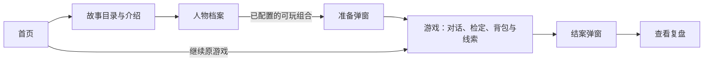

# 当前网页设计与展示范围

## 玩家走过的页面

React 负责显示和输入；剧情与数值判断由后端处理。页面没有把隐藏故事文件打包到前端。
代码入口为 [App.tsx](../frontend/src/App.tsx)，真实数据通过 `/api` 获取。

## 故事与人物页

故事卡片和介绍来自目录接口，当前可见雨夜来信与岭下暗影。
介绍中的地点名称是发布清单明确允许显示的内容，不是前端直接扫描所有隐藏场景。

人物页有概览、属性技能、背景和初始物品四个标签。
人物、头像和物品说明来自服务器公开投影；箱中物品保留层级说明，未知数量显示为未知。
按用户确定的页面风格，人物与故事资料自然陈列，不显示“仅供查看”“暂未开放游玩”等标签。
实际创建仍由前后端依据 `playable` 与允许名单控制，不能因为去掉标签就把资料展示写成玩法已经接入。

主要组件：[ModuleLibrary](../frontend/src/components/ModuleLibrary.tsx)、
[InvestigatorSelection](../frontend/src/components/InvestigatorSelection.tsx)、[Portrait](../frontend/src/components/Portrait.tsx)。

## 游戏页

对话区显示玩家与 KP 正文，规则依据可展开查看。
侧栏显示当前人物数值，背包、线索和历史通过抽屉查看。
检定使用独立卡片，伤害表达式与 D100 检定分开；实际变化依据后端快照，不由前端重算骰子。

当前合法建议帮助玩家继续，也允许自由输入。输入法确认、等待时重复发送、流式中文拆分和重复事件都在前端处理。
背景与在场人物图片由本局授权接口返回，返回已访问地点不会重置剧情。

结束调查先确认；最终正文保存后显示结案，关闭弹窗可回看历史。
结束后不能继续行动，但可以点击“查看复盘”。信息不足和主动撤退保留各自标题，不套用完整结局。

主要组件：[GamePage](../frontend/src/components/GamePage.tsx)、[GameDrawer](../frontend/src/components/GameDrawer.tsx)、
[GameCheckCard](../frontend/src/components/GameCheckCard.tsx)、[GameReviewDialog](../frontend/src/components/GameReviewDialog.tsx)。

## 继续与恢复

浏览器只记住最近游戏编号，完整进度在后端。首页读取原局状态后提供继续入口。
页面刷新不新开一局；未完成回合沿用原请求恢复，不因为连接重开再次掷骰。
这不包含账号、云同步、多人或跨设备自动发现存档。

## 来源与验证

界面布局和部分组件沿用了队友已有的网页工作，按当前 Agent、接口、三地点故事与人物资料完成整合。
来源和旧设计链接在 [历史目录](history/README.md)，不把备份分支的玩法成绩算成本版的验证。
当前通过的前端构建和适配检查见 [命令输出](evaluation/frontend-checks.json)；演示见 [demo-guide](demo-guide.md)。
