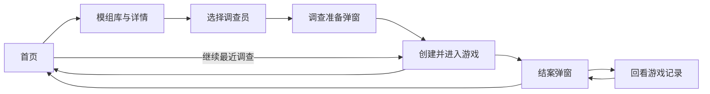

# 用户旅程与当前前端行为

更新日期：2026-10-24。当前链路使用真实目录、人物、游戏 HTTP／SSE 和后端 JSON 保存。

## 1. 主流程

产品面向电脑端单人游玩，四个页面，准备和结案使用弹窗，没有独立创建／总结页。

| 页面／弹窗 | 地址 | 玩家操作 | 当前状态 |
|---|---|---|---|
| 首页 | `#/` | 开始或继续调查 | 恢复本浏览器最近一局 |
| 模组库／详情 | `#/modules` | 翻页、看引言、选模组 | 真实发布目录 |
| 选择调查员 | `#/investigators?module=<id>` | 浏览十人档案并确认 | 真实公开资料与头像 |
| 调查准备弹窗 | 保留调查员页地址 | 核对后“开始调查” | POST创建，失败沿用请求ID重试 |
| 游戏主界面 | `#/game?game=<game_id>` | 自由行动、检定、回看 | GET恢复，POST行动SSE |
| 结案弹窗 | 保留游戏页地址 | 总结、回看、返回首页 | 保存最终正文后显示 |

## 2. 首页：开始与继续

“开始调查”进入模组库。创建成功或打开有效游戏地址后，浏览器只记住最近可恢复的game_id；完整角色、对话、线索和进度仍在后端。首页通过GET校验后启用“继续调查”，显示案件和调查员姓名，点击打开原游戏，不创建新局、不调用模型。

没有编号或这局已完整结案时按钮灰显，提示“暂无进行中的调查”。明确404也清除编号；网络、损坏或版本错误保留编号，显示错误和“重新检查”。不把临时故障当作存档丢失。首页重新进入、窗口聚焦及其他标签更改编号时重新校验。

若存在未完成回合，入口标注“有未完成回合”，进入游戏后沿用“恢复本轮”。HP/SAN已经终局但最终正文未保存的回合也可恢复。结束旧局只清除相同编号，不会误删另一标签新局的入口。

仅支持同一浏览器、同一站点的最近一局，没有“我的调查”列表或跨设备发现。此前已有的存档须用原地址打开一次后才能记住；清理浏览器数据不会删除后端存档，仍可用原地址进入。存储被浏览器禁用时游戏和原URL恢复仍可用。全站设置入口已移除，动画遵循系统减少动态效果偏好。

## 3. 模组库与详情

桌面左侧卡片、右侧详情，同页切换。每页最多三项，左右翻页，首尾禁用、末页不补空卡。当前仅发布《岭下暗影》；封面、标题和引言通过后端返回，不放占位模组。隐藏的年代／地点／人数／预览来源提示没有重新加入页面。

“选择调查员”携带模组ID进入下一页。目录的`runtimeProfile`明确绑定独立单人改编；旧`preview`字段不代表完整原模组已全面可运行。

## 4. 选择调查员

桌面十人照片墙及右侧档案。首次无默认选择，选中后读取公开详情；切换人物取消旧请求。档案分人物概览、属性技能、人物背景、初始物品四标签，支持方向键／Home／End，长内容内部滚动，不撑高整页。

“确认调查员”打开准备弹窗，“开始调查”创建后端游戏实例并进入含game_id的地址。人物属性和背景不在网页编辑，模板不回写。创建失败沿用原请求ID；目录读取失败可重试，无效模组提供返回入口。

## 5. 游戏：阅读、行动与恢复

顶部为案件和对话记录；侧栏显示调查员头像、HP／SAN／MP／幸运及人物／物品／线索工具。场景背景和NPC立绘分层，通过本局素材接口授权，随六场景与乔什时间线更新。无人时隐藏立绘。Keeper以文字叙述。

1. 在固定高度、内部滚动的对话区阅读正文。
2. 自由输入，或点击当前合法事件生成的建议填入草稿；建议不自动发送。
3. Enter／行动发送，Shift+Enter换行；输入法确认不误发。
4. 等待时禁止重复提交；SSE依次展示自动检定卡、真实资源／物品／线索变化和流式正文。
5. 成功后清空草稿；回看历史可点“最新内容”。多个检定顺序展示，出目由服务端决定，刷新不重播动画。

AI只将自然语言映射到配置中的一个主要行动；未支持方法给予解释，问答／假设不擅自执行。普通D100、HP／SAN、关键装备、线索和简化危险由服务端执行，不是固定回复。MP／幸运暂仅展示。检定失败和网络错误分别呈现。

页面刷新、离开再进入或后端重启后GET恢复原状态和完整历史。中断行动先显示“恢复本轮”，禁止改文本换新请求；点击后沿用原请求ID。出目与效果不重做，未完成正文可重新生成。回到首页不会结束调查，普通回头和场景移动也不会结案。

人物、物品、线索和完整对话在抽屉中回看，可关闭／Escape并返回焦点。没有手动存档按钮，服务端自动保存。

## 6. 结案

调查完成、明确撤离或HP／SAN归零触发结案。地下结束先确认；最终结果按实际乔什同行／营救／留下的状态叙述。最终正文保存后才弹“调查结束”，直接复用该回复，不额外生成总结。

行动区替换为结束提示和“查看结案”；关闭／Escape可以回看和重新打开，不能继续行动。“返回首页”离开游戏，已完整结案的相同最近编号会清除。长总结在弹窗内部滚动，返回按钮保持可见。

## 7. 边界与说明

单人、单进程／worker。完整存档位于`backend/saves/<game_id>/game.json`，CLI SQLite独立，不做网页格式迁移。浏览器只存game_id，游戏URL仍是本地恢复凭证；不提供账号、多设备同步、多局列表或多人联机。

路由见`frontend/src/App.tsx`，首页入口见`ContinueInvestigation.tsx`，浏览器编号见`src/state/recent-game.ts`。目录、人物、游戏见`ModuleLibrary.tsx`、`InvestigatorSelection.tsx`、`GamePage.tsx`；抽屉和结案见`GameDrawer.tsx`、`InvestigationEndingDialog.tsx`。

- [网页HTTP／SSE](interfaces.md)、[调查员接口](investigator-api.md)。
- [模组存储](module-storage.md)、[人物存储](character-storage.md)。
- [继续调查实施与验证](design/done/resume-investigation.md)、[MVP验证](evaluation/playable-mvp.md)。
