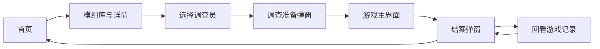

# 用户旅程与当前前端行为

更新日期：2026-10-23。按当前 React 路由、组件和 mock 适配编写，区分界面行为与真实游戏能力。

## 1. 主流程

产品面向电脑端单人游玩。目前是四个页面，结案包含在游戏页中，没有独立结案路由或“创建调查”页面。

| 页面／弹窗 | 地址 | 玩家操作 | 当前状态 |
|---|---|---|---|
| 首页 | `#/` | 开始调查 | 已实现；继续调查灰显 |
| 模组库／详情 | `#/modules` | 翻页、查看公开引言、选择模组 | 后端真实发布目录 |
| 选择调查员 | `#/investigators?module=<id>` | 浏览十人档案、选择并确认 | 后端真实公开资料与头像 |
| 调查准备弹窗 | 保留调查员页地址 | 核对案件、人物和职业，进入预览 | 不创建后端游戏 |
| 游戏主界面 | `#/game?module=<id>&investigator=<id>` | 输入行动、阅读回应、使用抽屉 | 依赖目录 API 的开场预览 |
| 结案弹窗 | 保留游戏页地址 | 简短总结、返回首页 | 由演示结束响应触发 |

游戏示例地址为 `#/game?module=darkness-beneath-the-hill&investigator=stephen`。参数仅保存所选案件与人物，不是存档或真实 `game_id`。

## 2. 首页：进入调查

“开始调查”进入模组库。“继续调查”暂不可用，没有“我的调查”列表、存档恢复或多人联机。

全站设置入口已移除；动画遵循系统减少动态效果偏好。健康检查仍供开发使用。

## 3. 模组库与详情：选择案件

- 桌面左侧卡片、右侧详情，同页切换，没有单独详情路由。
- 每页最多三项，左右翻页；首尾按钮禁用，末页不补空卡。
- 当前发布清单仅有《岭下暗影》，不补占位卡；增加模组后沿用左右分页。
- 详情展示封面、标题及公开引言；年代／地点／玩法／原作人数／内容提示和预览标签已移除。
- 点击“选择调查员”携带模组 ID 进入下一页。

目录来自 `backend/data/module-catalogue.json`，通过真实 GET 列表／详情读取。`preview` 表示能进入 UI 预览，不代表整个模组已可运行。

## 4. 选择调查员：了解并确认角色

桌面为十人照片墙和右侧档案。首次无默认选择，确认按钮禁用；选中人物后读取详情。

| 标签 | 内容 |
|---|---|
| 人物概览 | 简介、HP／SAN／MP／幸运、主要技能 |
| 属性技能 | 八属性与技能；未知值显示“—” |
| 人物背景 | 分段背景和未填写栏目 |
| 初始物品 | 随身物品、拥有资产、数量和现金 |

档案高度随视口保持稳定，长标签内容内部滚动，不撑高整页；标签支持方向键、Home 和 End。

“确认调查员”打开准备弹窗，再点“进入调查预览”进入游戏。当前没有编辑属性、填写背景或正式角色实例创建流程。页面人物资料由后端 YAML／Markdown 投影而来，不会因选择而修改原模板。

切换人物会取消旧详情请求。缺少、无效或未开放模组时提示返回；列表／详情读取失败可重试。

## 5. 游戏：阅读、行动和回看

### 场景与身份

顶部为案件、对话记录和设置。左侧为所选调查员头像、资源及工具入口；中央为独立住宅背景和乔什 NPC 立绘。玩家头像留在侧栏，Keeper 通过文字叙述。

当前只有住宅会面场景，未接完整地点切换、战斗或怪物遭遇。两张开场图是明确选用的静态预览，其他后台素材不会自动公开。

### 行动循环

1. 在固定高度的叙事区阅读 Keeper 描述与 NPC 台词，长记录内部滚动。
2. 输入自然语言；也可点击“询问隧道／查看地窖入口／准备探索装备”填入输入框，建议不会自动发送。
3. 点击“行动”或 Enter 发送；Shift+Enter 换行，composition／229 防止输入法确认误发。
4. 等待时只读并防止重复发送。成功后清空草稿；失败保留行动，允许重试／编辑。
5. 消息加入记录，公开事实按 ID 去重加入线索。回看旧记录时可点“最新内容”回到底部。

目前建议固定，回复是有限关键词脚本，未实现 LLM 理解或动态建议生成；未知行动会说明预览范围。讨论装备不会自动发放物品，人物资源不会随 mock 对话结算变化。

### 工具抽屉

人物、物品、线索和完整记录均在游戏内打开，不跳转页面，支持关闭／Escape 和焦点返回。线索初始为空，只展示演示交谈获得的信息。游戏页已删除“存档 · 暂未开放”按钮。

设置及其检定／结案演示入口已移除，底层预览适配仍可离线验证。

## 6. 结案：在游戏内收尾

初始化／行动响应收到 `ended: true` 后，取该响应最后一段 Keeper 叙述，显示“调查结束”、总结和“返回首页”。没有文本时使用中性提示，不编造结局。不额外调用总结接口，不要求统计或奖励页面。

结束后清空草稿，行动区替换为结束提示和“查看结案”。关闭弹窗可以回看记录、重开结案，但不能继续发送。返回首页离开本次预览。当前结束响应仅在适配层演示测试中使用，尚未由真实游戏条件驱动。

## 7. 状态与实现边界

| 情况 | 当前行为 |
|---|---|
| 刷新游戏页 | 沿用 URL 的案件／人物，回到开场；消息、线索和结束状态重置 |
| 离开再进入 | 重新初始化，不恢复历史 |
| 缺少上下文 | 提示先选择案件与调查员，提供返回入口 |
| 无效案件／人物 | 显示失败，可重试／返回，不默选默认人物 |
| 网页持久化 | 无存档，不用 localStorage／SQLite 保存当前旅程 |
| 真实 HTTP | 健康检查、模组列表／详情／封面、人物列表／详情／头像；游戏行动仍为演示 |
| 后续接入 | 后端负责实例创建、规则、场景、状态一致性、素材授权 |

现有 CLI 的 SQLite 存储独立存在，不代表网页存档已实现。当前 API 地址与契约的后续确认不需要新增页面。

## 8. 代码与相关说明

路由／首页见 `frontend/src/App.tsx`；目录、人物、游戏分别见 `ModuleLibrary.tsx`、`InvestigatorSelection.tsx`、`GamePage.tsx`；抽屉／结案见 `GameDrawer.tsx`、`InvestigationEndingDialog.tsx`。

- [调查员适配契约](investigator-api.md)、[游戏页适配草案](game-preview-api.md)。
- [模组存储结构](module-storage.md)、[人物存储结构](character-storage.md)。

## 2026-10-24：真实游戏接入

确认调查员后POST创建游戏，进入带game_id的地址；刷新GET恢复，不重复创建。自由行动通过SSE依次显示自动检定、状态变化及真实Keeper正文，建议点击只填输入框。物品／线索／人物资源与场景／NPC来自本局，错误时恢复原请求，结束后复用最终叙述弹窗并可返回首页。首页继续调查仍灰显，无存档管理，保留游戏地址可恢复。此前“固定回复／刷新重置”的游戏预览描述已由此链路替代。
